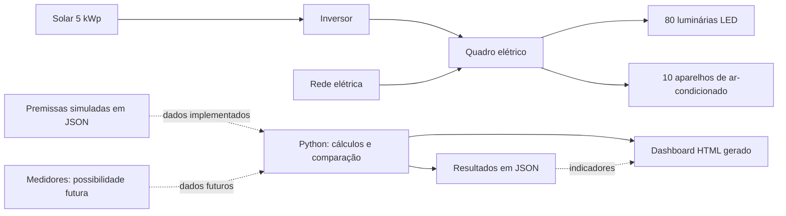

# Neighborhood Action Dashboard — Energia sustentável na escola

**Global Solution 2026.2 · SERS · Ciência da Computação**

| Integrante | RM |
|---|---|
| Letticia Aparecida Martins | 575441 |
| Kalil Bachur | 576335 |
| Gustavo Valentim de Souza | 575916 |

## 1. Problema e comunidade

Neste projeto, simulamos o consumo de iluminação e ar-condicionado de uma escola pública em São Paulo. A proposta combina redução de consumo com geração renovável para diminuir a energia comprada da rede.

O cenário considera **80 luminárias fluorescentes de 80 W**, usadas 8 horas por dia, e **10 aparelhos de ar-condicionado de 1.000 W**, usados 5 horas por dia. O mês de referência tem 22 dias letivos. Esses valores são premissas de dimensionamento, não resultados de uma visita ou de contas de energia. O consumo analisado inclui apenas esses dois usos, não toda a escola.

Alunos, professores, funcionários e a comunidade que utiliza o espaço são os beneficiários. A economia projetada pode liberar recursos para outras necessidades da escola. A climatização permanece igual nos cenários: não afirmamos melhoria térmica ou economia específica do ar-condicionado.

## 2. Premissas e método

**Energia elétrica:** `E = potência em W × quantidade × horas / 1000`.

| Premissa | Valor e natureza |
|---|---|
| Funcionamento da iluminação | 8 h/dia × 22 dias = 176 h/mês |
| Funcionamento do ar-condicionado | 5 h/dia × 22 dias = 110 h/mês |
| Tarifa | R$ 0,95/kWh — hipótese uniforme para comparação; não média oficial |
| LED proposto | 36 W por luminária — equivalência luminosa assumida, a validar |
| Sistema fotovoltaico | 5 kWp; 4,3 h/dia de sol pleno; desempenho de 80% |
| Geração solar considerada | Somente 22 dias letivos; demais dias/créditos excluídos |
| Instalação LED | R$ 450 por luminária instalada — hipótese de orçamento |
| Instalação solar | R$ 4.200/kWp — hipótese de orçamento |
| Reserva anual de manutenção | 1% do investimento de cada alternativa — hipótese didática |
| Fator histórico de emissões | 0,0385 kg CO₂/kWh, SIN de 2023 |
| Projeção anual | 12 meses equivalentes; não representa calendário escolar real |

A potência de 80 W representa duas lâmpadas fluorescentes de 36 W e perdas aproximadas do reator. A potência do ar-condicionado é uma hipótese de potência elétrica, não sua capacidade térmica em BTU/h; o modelo não simula ciclos do compressor.

Para a solar usamos `E = potência (kWp) × HSP (h/dia) × dias × desempenho`. A irradiação de 4,3 kWh/m²/dia corresponde a 4,3 horas de sol pleno quando dividida pela irradiância de referência de 1 kW/m². O fator de 80% representa desempenho global, não eficiência física do painel. O valor 4,3 é hipótese do cenário; não foi comprovado por consulta às coordenadas de uma escola específica.

Os investimentos incluem, por hipótese, equipamento e instalação. Os valores não são cotações. As reservas de manutenção foram adotadas para não tratar operação como gratuita: R$ 360/ano para LED e R$ 210/ano para solar. A manutenção existente no cenário atual não foi levantada e está fora do escopo; as reservas entram conservadoramente como custos adicionais dos cenários propostos.

## 3. Diagnóstico de consumo

| Uso | Cálculo | Resultado |
|---|---|---:|
| Iluminação atual | 80 × 80 W × 176 h / 1000 | 1.126,40 kWh/mês |
| Ar-condicionado | 10 × 1.000 W × 110 h / 1000 | 1.100,00 kWh/mês |
| **Total dos dois usos** | Soma | **2.226,40 kWh/mês** |
| Custo da energia modelado | 2.226,40 × R$ 0,95 | R$ 2.115,08/mês |

Com LED, a iluminação passa a `80 × 36 × 176 / 1000 = 506,88 kWh/mês`. A redução é **619,52 kWh/mês**, equivalente a 55% da iluminação e **27,83% do consumo total analisado**. O ar-condicionado permanece em 1.100 kWh/mês.

A geração solar considerada é `5 × 4,3 × 22 × 0,80 = 378,40 kWh`. O sistema pode gerar também nos outros dias; essa produção não está contabilizada nesta estimativa conservadora.

## 4. Comparação de alternativas

As alternativas atendem à mesma demanda de serviço no mesmo período. A equivalência da iluminação é uma condição da comparação, que precisaria de validação em lúmens, distribuição luminosa e iluminância antes da instalação.

| Critério | A — LED | B — Solar | LED + Solar |
|---|---:|---:|---:|
| Demanda dos equipamentos, kWh/mês | 1.606,88 | 2.226,40 | 1.606,88 |
| Geração solar considerada, kWh/mês | 0,00 | 378,40 | 378,40 |
| Compra da rede, kWh/mês | 1.606,88 | 1.848,00 | 1.228,48 |
| Implantação, R$ | 36.000,00 | 21.000,00 | 57.000,00 |
| Reserva de manutenção, R$/mês | 30,00 | 17,50 | 47,50 |
| Energia comprada, R$/mês | 1.526,54 | 1.755,60 | 1.167,06 |
| Operação modelada*, R$/mês | 1.556,54 | 1.773,10 | 1.214,56 |
| Economia bruta, R$/mês | 588,54 | 359,48 | 948,02 |
| **Economia líquida**, R$/mês | **558,54** | **341,98** | **900,52** |
| Retorno simples bruto, meses | 61,2 | 58,4 | 60,1 |
| **Retorno simples líquido**, meses | **64,5** | **61,4** | **63,3** |

*Operação modelada = energia comprada + reserva de manutenção. Outros custos não levantados, encargos, juros, inflação e substituição futura do inversor não têm orçamento próprio neste modelo. O retorno é simples, não descontado.

| Aspecto | LED | Solar |
|---|---|---|
| Viabilidade | Substituição das luminárias, condicionada à compatibilidade elétrica e iluminação adequada | Requer verificar estrutura, área, orientação, sombreamento e conexão à rede |
| Benefício comunitário | Menor consumo mantendo a iluminação necessária | Fonte renovável para atender parte da demanda elétrica |
| Impacto ambiental | Menor energia demandada; retirada inicial exige descarte adequado de lâmpadas e reatores | Menor necessidade de energia da rede no balanço; fabricação e fim de vida não foram avaliados |
| Limitações | Investimento inicial e equivalência luminosa ainda a validar | Variabilidade solar, investimento, manutenção e condições do telhado |

**Escolha:** combinar LED e solar. O LED evita consumo antes de dimensionar a geração; a solar atende parte da demanda restante. A combinação tem a maior redução de compra da rede, mas exige os dois investimentos. Isso é uma proposta comparada, não uma decisão de implantação aprovada.

## 5. Diagrama e monitoramento



As setas superiores representam alimentação energética. As setas de dados separam a simulação implementada da medição futura. Não há medidores instalados, automação de equipamentos ou aquisição em tempo real.

A lógica implementada compara a energia calculada da rede em cada cenário com a referência atual. Se o cenário combinado ficar abaixo da referência, o painel sinaliza **redução projetada**; caso contrário, revisão necessária. A atualização ocorre ao editar as premissas e executar novamente o Python.

## 6. Indicadores do cenário combinado

| Indicador | Resultado e definição |
|---|---|
| Demanda dos equipamentos após LED | 1.606,88 kWh/mês |
| Compra de energia da rede | 1.228,48 kWh/mês |
| Redução da compra da rede | 997,92 kWh/mês, ou 44,82% |
| Redução de consumo por eficiência | 619,52 kWh/mês, ou 27,83% |
| Participação solar | 378,40 / 1.606,88 = 23,55% da demanda após LED |
| Economia bruta | R$ 948,02/mês |
| Economia líquida após reserva | R$ 900,52/mês |
| Retorno simples líquido | 57.000 / 900,524 = 63,3 meses |
| Emissões evitadas estimadas | 997,92 × 0,0385 × 12 = 461,04 kg CO₂/ano equivalente |

**Consumo e origem são diferentes:** a solar não reduz a demanda dos equipamentos. Os aproximadamente 45% referem-se à compra da rede; a eficiência do LED reduz o consumo em aproximadamente 28%.

O fator de emissões é uma referência histórica de 2023, não o fator de 2026. A publicação consultada informa CO₂, por isso a unidade foi mantida como CO₂ e não CO₂e. A projeção não é uma avaliação de ciclo de vida nem uma estimativa de emissões marginais efetivamente deslocadas.

## 7. Como executar

Requisito: **Python 3.8 ou superior**, sem pacotes adicionais.

```bash
python calculos.py
python -m unittest test_calculos.py -v
```

Depois abra `dashboard.html` no navegador. O Python gera `dados/resultados.json` e o HTML a partir de `modelos/dashboard.template.html`. Os gráficos são locais, sem CDN: funcionam sem internet. Para mudar o cenário, edite `dados/premissas.json` e execute novamente; não edite os números diretamente no HTML gerado.

```text
Trabalho_SERS_Final/
├── README.md
├── calculos.py
├── test_calculos.py
├── dashboard.html
├── APRESENTACAO_SERS.pptx
├── APRESENTACAO_SERS.pdf
├── ROTEIRO_VIDEO.md
├── ORIENTACOES_KALIL.md
├── dados/
│   ├── premissas.json
│   ├── resultados.json
│   ├── FONTES_E_PREMISSAS.md
│   └── notas_slides.json
└── modelos/
    └── dashboard.template.html
```

Esta pasta identifica a contribuição de SERS. A apresentação resume a análise e tem notas para o narrador. O roteiro inclui uma demonstração real do Python e do dashboard; a apresentação não substitui essa demonstração.

## 8. Limitações e referências

A estimativa pressupõe que a geração considerada possa atender à demanda no balanço mensal. Não há perfil horário, cálculo de autoconsumo simultâneo, créditos por excedentes ou tratamento detalhado da conta. Portanto, não garantimos que cada kWh gerado produza desconto integral na fatura.

Antes de implantação real: levantar consumo, tarifa e horários; validar iluminação equivalente; avaliar o telhado e a conexão; obter orçamento; considerar manutenção, férias, degradação, substituições e variação solar. As projeções são condicionadas às premissas, não resultados garantidos.

1. **MME / Agência Gov.** Geração de energia elétrica tem a menor emissão de CO₂ dos últimos onze anos. 14/02/2024. Dados do MCTI: 38,5 kg CO₂/MWh no SIN de 2023. [Publicação consultada](https://agenciagov.ebc.com.br/noticias/202402/geracao-de-energia-eletrica-tem-a-menor-emissao-de-co2-dos-ultimos-onze-anos-1).
2. **CRESESB / CEPEL.** Potencial Solar — SunData v3.0. Metodologia de irradiação diária média mensal por localidade e plano. [SunData](https://cresesb.cepel.br/sundata/index.php). Não comprova a hipótese de 4,3 h/dia deste cenário.
3. **ANEEL.** Tarifas. [Página institucional](https://www.gov.br/aneel/pt-br/assuntos/tarifas). Referência para consulta de tarifa específica, não comprovação da tarifa hipotética adotada.

Referências consultadas em 19/11/2026. A matriz completa de hipóteses e condições está em `dados/FONTES_E_PREMISSAS.md`.
